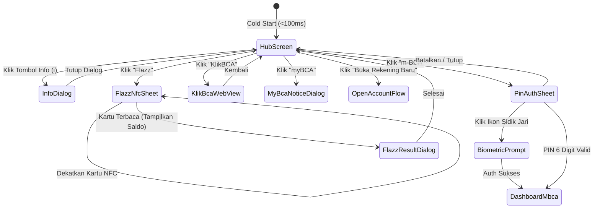

# Design & Architecture Document (BCA Mobile Android Native)

Dokumen ini menjelaskan arsitektur perangkat lunak, desain antarmuka pengguna (UI/UX Design System), spesifikasi token visual, dan pemodelan state untuk aplikasi **BCA Mobile Android** berbasis **Kotlin + Jetpack Compose**.

---

## 1. Arsitektur Perangkat Lunak

Aplikasi menggunakan kombinasi **Clean Architecture** dan pola **MVI / MVVM Reaktif** untuk memastikan modularitas, skalabilitas, keamanan data tinggi, dan performa UI 120 FPS tanpa jank.

```
+-----------------------------------------------------------------------------------+
|                           PRESENTATION LAYER (Jetpack Compose)                    |
|  +-----------------------------------------------------------------------------+  |
|  | BcaMobileTheme (Colors, Typography, Gradients, Shapes)                      |  |
|  | BcaHubScreen | PinAuthBottomSheet | FlazzReaderSheet | ModalInfoDialog      |  |
|  +-----------------------------------------------------------------------------+  |
|                                         ^                                         |
|                 collectAsStateWithLifecycle() | Emits UiEvents (Click/Input)      |
|                                         v                                         |
|  +-----------------------------------------------------------------------------+  |
|  | ViewModels (BcaHubViewModel, PinAuthViewModel, FlazzViewModel)              |  |
|  | - StateFlow<UiState> (Immutable Single Source of UI Truth)                  |  |
|  +-----------------------------------------------------------------------------+  |
+------------------------------------------+----------------------------------------+
                                           |
                                           v Invokes
+-----------------------------------------------------------------------------------+
|                                DOMAIN LAYER (Pure Kotlin)                         |
|  +-----------------------------------------------------------------------------+  |
|  | Use Cases:                                                                  |  |
|  | - AuthenticatePinUseCase (Verifikasi PIN 6 digit dengan batas toleransi)    |  |
|  | - ReadFlazzBalanceUseCase (Ekstraksi saldo kartu chip via NFC)             |  |
|  | - GetUserSessionUseCase | EncryptLocalDataUseCase                           |  |
|  +-----------------------------------------------------------------------------+  |
+------------------------------------------+----------------------------------------+
                                           |
                                           v Implements
+-----------------------------------------------------------------------------------+
|                                DATA LAYER (Android & Hardware)                    |
|  +-----------------------------------------------------------------------------+  |
|  | Repositories (AuthRepositoryImpl, FlazzRepositoryImpl, ConfigRepositoryImpl)|  |
|  +-----------------------------------------------------------------------------+  |
|         |                                              |                          |
|         v                                              v                          |
|  [Security & Storage]                         [Hardware & Peripherals]            |
|  - Android Keystore (AES-256 GCM)             - Android NFC Adapter (Flazz Tag)   |
|  - EncryptedSharedPreferences                 - BiometricManager (Fingerprint)    |
|  - Proto DataStore (Secure Cache)             - CameraX (QRIS Code Scanner)       |
+-----------------------------------------------------------------------------------+
```

---

## 2. Design System & Spesifikasi Visual Presisi

Merujuk pada prototipe visual BCA Mobile asli (`awal.jpeg` dan aset di prototype web), seluruh komponen visual direplikasi dengan tingkat presisi pixel-perfect.

### 2.1 Palet Warna & Gradient Tokens (`BcaColorTokens`)

```kotlin
object BcaColors {
    // Background Dark Navy Base
    val NavyBackground = Color(0xFF000518)
    val NavyRadialCenter = Color(0xFF001438)
    val NavyDeep = Color(0xFF000921)
    
    // Brand Accent & Borders
    val CardBorderWhite = Color(0xFFFFFFFF)
    val DividerWhite = Color(0xFFFFFFFF)
    val BadgeNewText = Color(0xFF004FA8)
    val BadgeNewBackground = Color(0xFFFFFFFF)
    
    // Row Menu Gradients (Linear 180 deg)
    val MenuRowGradient = Brush.verticalGradient(
        colors = listOf(
            Color(0xFF0196F2), // Light metallic blue top
            Color(0xFF015DB5), // Mid classic blue
            Color(0xFF003789)  // Deep royal navy bottom
        )
    )
    
    // 3D Glossy Action Buttons (Buka Rekening Baru & Flazz)
    val ActionButtonGradient = Brush.verticalGradient(
        colors = listOf(
            Color(0xFF1899ED), // Top gloss highlight
            Color(0xFF008DE5),
            Color(0xFF0167BC),
            Color(0xFF013F92),
            Color(0xFF02368A)  // Deep metallic base
        )
    )
    
    // Text Shades
    val TextWhite = Color(0xFFFFFFFF)
    val TextDisclaimer = Color(0xF2FFFFFF) // 95% opacity white
    val TextMuted = Color(0xFFB0C5DE)
}
```

### 2.2 Spesifikasi Komponen UI Utama

#### A. Main Background (Radiant Starburst)
- **Komponen Compose:** Custom `Box` dengan `drawBehind` Canvas atau `Image` bitmap aset `bg_bca_wallpaper`.
- **Rasio:** Full screen (Edge-to-Edge) dengan `contentScale = ContentScale.Crop`.
- **Dimensi Max Container:** `maxWidth = 448.dp` (centered di layar tablet/desktop, 100% lebar di smartphone).

#### B. Top Info Header
- **Tombol:** Lingkaran diameter `28.dp` transparan dengan ikon bulat putih info `(i)` di pojok kanan atas.
- **Padding:** `top = 16.dp`, `end = 18.dp`.

#### C. Logo Area
- **Aset:** `bca_mobile_logo.png` (resolusi ultra-tajam).
- **Ukuran:** Lebar responsif 60% dari container (maksimum `250.dp`).
- **Drop Shadow:** `Color(0x59000000)` dengan blur `10.dp`.

#### D. 3-Row Action Menu Container
- **Border:** `2.dp` Solid White (`Color.White`).
- **Corner Radius:** `18.dp`.
- **Box Shadow:** `Color(0x80000C28)` dengan blur `24.dp`, offset Y `8.dp`.
- **Struktur Baris (Tinggi per baris: `78.dp` - `84.dp`):**
  1. **Baris 1 (`m-BCA`):** Ikon tile persegi membulat (corner radius 14dp) + Teks tebal `"m-BCA"` (21sp). Divider bawah putih 2dp.
  2. **Baris 2 (`KlikBCA`):** Ikon tile rounded + Teks tebal `"KlikBCA"` (21sp). Divider bawah putih 2dp.
  3. **Baris 3 (`myBCA`):** Ikon tile rounded + Teks tebal `"myBCA"` (21sp) + Kapsul badge pill putih bertuliskan `"NEW!"` (10sp font tebal warna `#004fa8`).

#### E. Glossy 3D Action Buttons (`Buka Rekening Baru` & `Flazz`)
- **Tinggi:** `52.dp` - `56.dp`.
- **Corner Radius:** `16.dp`.
- **Tipografi:** Teks tebal putih (20sp), *sans-serif*, center-aligned.
- **Efek Presisi:** Gradien vertikal 5-stop dengan shadow biru gelap pekat.
- **Interaksi:** Skala reduksi `0.985f` saat disentuh (animated via `animateFloatAsState`).

#### F. Regulatory Disclaimer (Kepatuhan OJK/BI)
- **Teks:**
  ```text
  BCA berizin dan diawasi oleh
  Otoritas Jasa Keuangan & Bank Indonesia.
  BCA merupakan peserta penjaminan LPS.
  ```
- **Tipografi:** Putih 95% opacity, ukuran `11.sp`, line height `15.sp`, rata tengah, padding bawah `24.dp`.

---

## 3. Alur Navigasi & Interaksi Antar-Layar



---

## 4. Pemodelan State UI (MVI / Unidirectional Data Flow)

### 4.1 State Layar Hub (`HubUiState`)

```kotlin
sealed interface HubUiState {
    data class Success(
        val isFlazzSupported: Boolean = true,
        val isBiometricAvailable: Boolean = false,
        val lastLoginTime: String? = null,
        val activeModal: ActiveModalType = ActiveModalType.None
    ) : HubUiState
    
    data object Loading : HubUiState
}

enum class ActiveModalType {
    None,
    Info,
    MyBcaRedirect,
    FeatureComingSoon
}
```

### 4.2 State Autentikasi PIN (`PinAuthUiState`)

```kotlin
data class PinAuthUiState(
    val enteredPinLength: Int = 0,
    val maxPinLength: Int = 6,
    val isVerifying: Boolean = false,
    val remainingAttempts: Int = 3,
    val errorMessage: String? = null,
    val isBiometricOffered: Boolean = true,
    val isSuccess: Boolean = false
)
```

### 4.3 State Pembacaan Kartu Flazz (`FlazzUiState`)

```kotlin
sealed interface FlazzUiState {
    data object Idle : FlazzUiState
    data object WaitingForCard : FlazzUiState // Animasi gelombang radar NFC
    data object ReadingCard : FlazzUiState
    data class CardReadSuccess(
        val cardNumberFormatted: String, // Contoh: "6019 **** **** 1234"
        val balanceAmount: Long,         // Contoh: 150000 -> "Rp 150.000"
        val lastTopUpDate: String
    ) : FlazzUiState
    data class CardReadError(val message: String) : FlazzUiState
}
```

---

## 5. Anggaran Performa (Performance Budget)

| Parameter | Target Maksimum | Strategi Pencapaian |
|---|---|---|
| **Cold Start Time** | **< 150 ms** | Tidak ada inisialisasi berat di `Application.onCreate()`, Jetpack App Startup |
| **Ukuran APK Release** | **< 6.0 MB** | ProGuard/R8 Full Mode, WebP asset compression, Vector Drawables |
| **Konsumsi Memori (RAM)** | **< 45 MB** | Zero WebView di layar utama, Compose runtime hemat alokasi heap |
| **Frame Rate Rendering** | **60 - 120 FPS** | `Modifier` stabil, hindari recomposition loop dengan `remember` & `derivedStateOf` |
| **Keamanan Data** | **Grade A (OWASP MASVS)** | Hardware-backed Android Keystore, Anti-Rooting, `FLAG_SECURE` |
