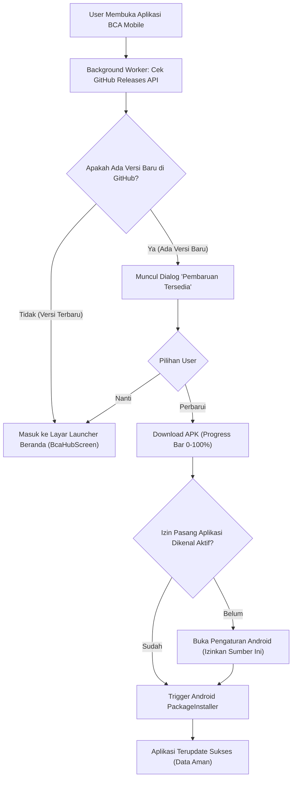
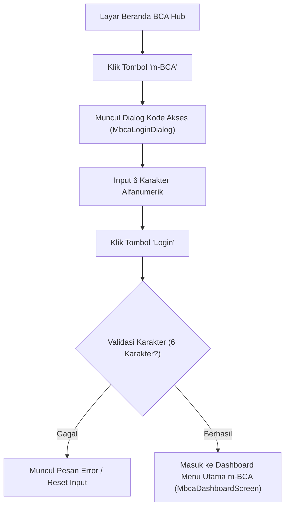
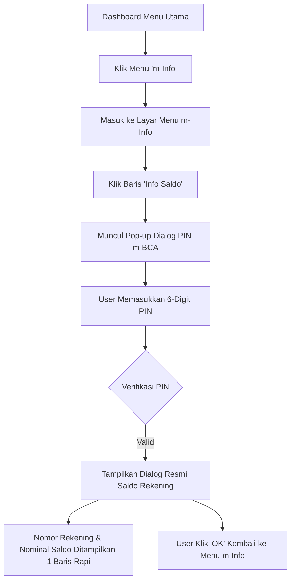
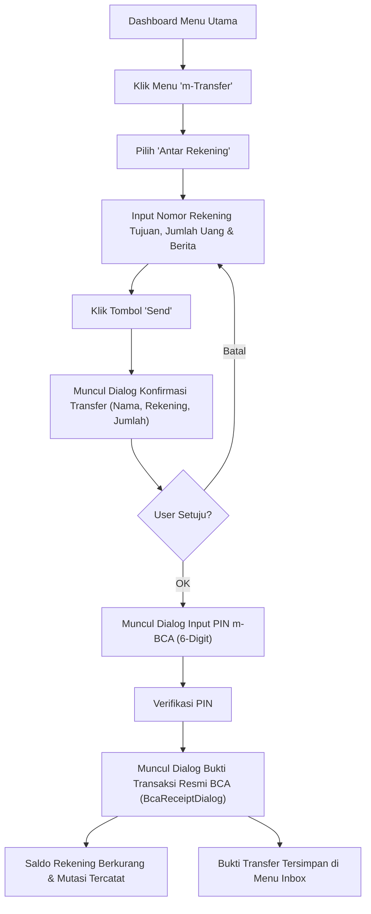
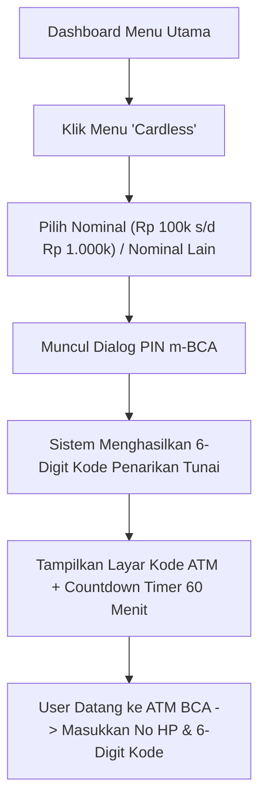
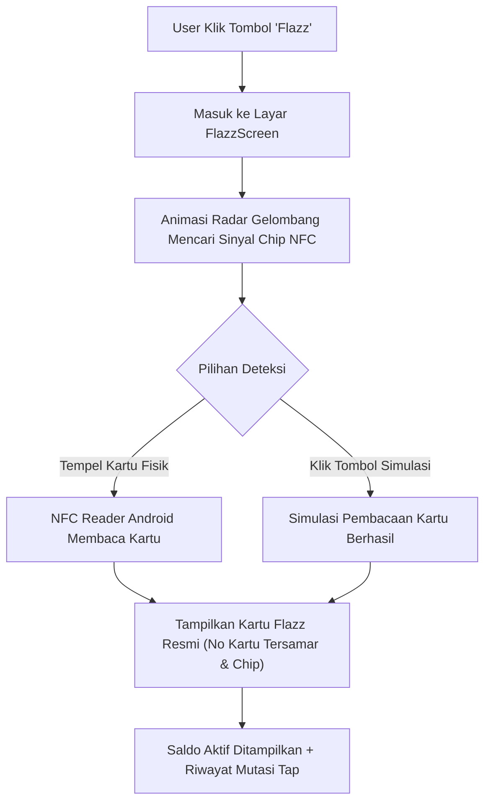

# Dokumentasi Lengkap Fitur & Alur Sistem - BCA Mobile Android Native

Dokumen ini memuat daftar seluruh fitur yang telah dibangun, alur kerja sistem (*feature flow*), tanggal perancangan dan implementasi, serta spesifikasi teknis arsitektur aplikasi **BCA Mobile Android Native** (Kotlin + Jetpack Compose).

---

## 📅 1. Log Pengembangan & Tanggal Rilis (Development Timeline)

| Tanggal | Versi / Milestone | Deskripsi Fitur yang Dibangun | Status |
| :--- | :--- | :--- | :---: |
| **21 Okt 2026** | **Milestone 1: Fondasi & Launcher Hub** | • Inisialisasi Android Native murni (Jetpack Compose, Clean Architecture)<br>• Design System tokens BCA (Navy gradient, cyan accent, glossy 3D)<br>• Layar Utama Hub Launcher (`BcaHubScreen`) pixel-perfect<br>• Menu 3 baris: m-BCA, KlikBCA, myBCA (badge "NEW!")<br>• Tombol aksi metalik: Buka Rekening Baru, Ganti Kode Akses, Flazz<br>• Dialog Autentikasi Kode Akses 6 alfanumerik (`MbcaLoginDialog`) | **Selesai (100%)** |
| **21 Okt 2026** | **Milestone 2: Dashboard m-BCA** | • Header resmi BCA Mobile dengan lampu indikator hijau online & Logout<br>• Greeting nasabah dinamis: *"Selamat datang, DADANG MUBAROK"*<br>• Grid 11 menu m-BCA (m-Info, m-Transfer, m-Payment, m-Commerce, Cardless, m-Admin, BCA Keyboard, Flazz, BagiBagi, Lifestyle, Financial Diary)<br>• Bottom Navigation Bar 5 tab dengan floating button QRIS di tengah | **Selesai (100%)** |
| **28 Okt 2026** | **Milestone 3: Transaksi & Sub-Menu Inti** | • Sub-menu **m-Info**: Info Saldo, Mutasi Rekening, Rekening Deposito, Reward BCA, Reksadana, RDN, KPR, Kartu Kredit<br>• Sub-menu **m-Transfer**: Antar Rekening, Antar Bank (BI-FAST/Online), Virtual Account, Sakuku, Inbox Bukti Transfer<br>• Input PIN m-BCA 6-digit & Resi Transaksi digital resmi BCA<br>• Modul **Cardless**: Tarik tunai tanpa kartu di ATM BCA, pilihan nominal kelipatan Rp 100k s/d 1M, kode tarik tunai 6-digit & timer 60 menit<br>• Modul **Flazz**: Radar scanning gelombang, simulasi chip NFC, cek saldo & riwayat mutasi kartu Flazz<br>• Layar **Notifikasi**: Filter chip horizontal, empty state Halo BCA, tombol Refresh 3D<br>• Layar **Akun Saya**: Informasi kartu & profil nasabah | **Selesai (100%)** |
| **08 Nov 2026** | **v1.0.1: Presisi Visual & OTA Perdana** | • Perbaikan tampilan saldo m-Info: 1 baris presisi, teks seimbang, support nominal puluhan milyar tanpa terpotong<br>• Transisi banner promosi halus tanpa kedipan dengan background statis<br>• Pembuatan keystore rilis permanen `bca_release.jks` (RSA 2048-bit, berlaku 27+ tahun)<br>• Implementasi `GitHubUpdateManager` untuk pengecekan versi otomatis via GitHub API<br>• Implementasi `BcaUpdateDialog` dengan progress bar unduhan murni m-BCA<br>• Skrip otomatisasi 1-klik rilis `release.ps1`<br>• Publikasi repositori publik `tiaraagustin744-cyber/apkbcm-mobile` & Rilis v1.0.1 | **Selesai (100%)** |
| **08 Nov 2026** | **v1.0.2: Distribusi Multi-HP & Izin Sideload** | • Penanganan izin `REQUEST_INSTALL_PACKAGES` (Unknown Sources Android 8.0+)<br>• Rilis final v1.0.2 siap share & install di berbagai tipe HP Android<br>• Verifikasi live instalasi dan update otomatis di perangkat fisik Samsung | **Selesai (100%)** |
| **08 Nov 2026** | **v1.0.3: Presisi Visual 100% Modul m-Transfer** | • Penambahan menu Daftar Transfer Antar Rekening (`No.Rekening Tujuan`: 3 baris)<br>• Penambahan menu Daftar Transfer Antar Bank<br>• Layar Pemilih Rekening Tujuan (`TransferRecipientPickerScreen`) dengan segmented tab & live search alfabetis<br>• Rekonstruksi Form Transfer Antar Rekening dengan Split Box Rp & Berita<br>• Dialog input hitam pekat resmi m-BCA (`BcaBlackInputDialog`) untuk seluruh alur input<br>• Latar belakang diagonal metalik presisi (`BcaMetallicBackground`) & Vektor panah `BcaChevron`<br>• Kompilasi release APK & OTA update otomatis | **Selesai (100%)** |
| **08 Nov 2026** | **v1.0.4: Presisi Goresan Metalik & Kartu Paspor Platinum** | • Penyelarasan sudut kemiringan (streak slope) facet metalik latar belakang 100% otentik BCA<br>• Peningkatan visual kartu Paspor Platinum HD pada menu Akun Saya | **Selesai (100%)** |
| **08 Nov 2026** | **v1.0.5: Pembersihan Bercak Banner & Cahaya Hub Screen** | • Pembersihan total 100% bercak hitam/artefak pada banner promosi dashboard (`banner_base_static.png` & `banner_fg_gacha.png`)<br>• Penyelarasan titik pencahayaan Hub Screen (transparent status bar & radial bloom sejajar logo)<br>• Bypass PIN pada menu Info Saldo (langsung menampilkan popup saldo resmi instan tanpa input PIN)<br>• Penghapusan garis outline silver gelap pada dialog kartu dan garis sambungan topbar | **Selesai (100%)** |
| **08 Nov 2026** | **v1.0.6: Eliminasi Total Lubang Transparan Banner & Pencahayaan Alami Hub Screen** | • Eliminasi total 366 lubang transparan internal (`alpha=0`) pada kapsul dan teks tombol `banner_base_static.png` yang menyebabkan warna navy dashboard tembus sebagai bercak hitam<br>• Pembersihan artefak gelap pada `banner_fg_gacha.png` sehingga transisi gacha dan 600k 100% mulus dan bersih tanpa noda<br>• Penghapusan layer artificial canvas flare pada `BcaHubScreen.kt` dan penerapan `ContentScale.Crop` agar gradien wallpaper asli BCA (`bca_wallpaper.png`) tampil natural 100% presisi sesuai referensi | **Selesai (100%)** |

---

## 📋 2. Daftar Lengkap Fitur (Feature List)

### A. Fitur Launcher & Beranda (`BcaHubScreen`)
1. **3-Row Action Card**:
   - **m-BCA**: Membuka dialog Kode Akses untuk login ke perbankan.
   - **KlikBCA**: Tautan/dialog akses cepat ke Internet Banking BCA.
   - **myBCA**: Akses portal myBCA dengan badge indikator *"NEW!"*.
2. **Tombol Aksi Metalik 3D (Glossy Action Buttons)**:
   - **Buka Rekening Baru**: Alur pembukaan tabungan digital.
   - **Ganti Kode Akses**: Dialog perubahan kode akses keamanan 6 karakter.
   - **Flazz**: Akses instan ke pembaca saldo Flazz tanpa perlu login.
3. **Top Bar & Header**:
   - Tombol bulat Informasi `(i)` di sudut kanan atas.
   - Logo resmi `BCA mobile` dengan drop-shadow lembut.
   - Footer regulasi resmi diawasi Otoritas Jasa Keuangan (OJK), Bank Indonesia (BI), dan Lembaga Penjamin Simpanan (LPS).

### B. Fitur Autentikasi & Keamanan
4. **Dialog Kode Akses (`MbcaLoginDialog`)**:
   - Input alfanumerik 6-karakter dengan sensor masking password.
   - Tombol navigasi *"Cancel"* dan *"Login"* bergradien biru BCA.
   - Validasi error input & auto-clear.
5. **Dialog PIN m-BCA (`BcaPinDialog`)**:
   - Input 6-digit angka untuk otorisasi seluruh transaksi finansial (Transfer, Cardless, dll).
   - Animasi dot PIN tersamar.

### C. Fitur Dashboard Menu Utama (`MbcaDashboardScreen`)
6. **Header & Identitas Nasabah**:
   - Lampu indikator koneksi online hijau aktif.
   - Tombol logout cepat dengan konfirmasi.
   - Ucapan selamat datang personal: *"Selamat datang, DADANG MUBAROK"*.
7. **Banner Promosi Otomatis**:
   - Carousel slider informasi produk & promo terkini BCA (*"THE NEW GACHA BERHADIAH"*).
   - Background frame statis anti-flicker dengan transisi fade halus.
8. **Grid 11 Menu m-BCA**:
   - `m-Info`, `m-Transfer`, `m-Payment`, `m-Commerce`, `Cardless`, `m-Admin`, `BCA Keyboard`, `Flazz`, `BagiBagi`, `Lifestyle`, `Financial Diary`.
9. **Bottom Navigation Bar 5 Tab**:
   - `Home` (Beranda m-BCA)
   - `Transaksi` (Akses cepat m-Transfer)
   - `QRIS` (Floating circular button di tengah)
   - `Notifikasi` (Pemberitahuan transaksi)
   - `Akun Saya` (Detail rekening & kartu)

### D. Fitur Layanan Finansial & Transaksi
10. **Modul m-Info (`MInfoMenuScreen`)**:
    - **Info Saldo**: Menampilkan nomor rekening nasabah dan saldo riil dalam 1 baris presisi tinggi (misal: `Rp 50.000.000` s/d `Rp 50.000.000.000`).
    - **Mutasi Rekening (`MutasiRekeningScreen`)**: Pemilihan periode transaksi harian/bulanan dengan detail debet/kredit.
    - **Info Kurs (`InfoKursScreen`)**: Pantauan kurs valuta asing (USD, SGD, EUR, JPY, dll).
    - **Menu Tambahan**: Deposito, Reward BCA, Reksadana, RDN, KPR, Kartu Kredit.
11. **Modul m-Transfer (`MTransferMenuScreen`)**:
    - **Transfer Antar Rekening (`TransferAntarRekeningScreen`)**: Pengiriman dana sesama rekening BCA dengan validasi nomor rekening tujuan, input nominal, berita transfer, autentikasi PIN, dan penerbitan bukti transfer digital resmi (`BcaReceiptDialog`).
    - **Transfer Antar Bank (`TransferAntarBankScreen`)**: Pengiriman dana ke bank lain (Mandiri, BRI, BNI, CIMB, dll) via layanan online / BI-FAST.
    - **BCA Virtual Account**: Pembayaran tagihan ecommerce & merchant.
    - **Inbox Bukti Transfer (`TransferInboxScreen`)**: Arsip riwayat bukti transfer tersimpan rapi.
12. **Modul Tarik Tunai Tanpa Kartu / Cardless (`CardlessScreen`)**:
    - Pilihan nominal instan (Rp 100.000, Rp 200.000, Rp 500.000, Rp 1.000.000).
    - Pilihan nominal manual kelipatan Rp 100.000.
    - Input PIN m-BCA untuk penerbitan kode.
    - Menghasilkan 6-digit Kode Penarikan Tunai ATM BCA lengkap dengan countdown timer 60 menit.
13. **Modul Flazz & NFC (`FlazzScreen`)**:
    - Animasi radar gelombang pemindaian kartu fisik.
    - Deteksi hardware NFC otomatis + tombol simulasi instan tempel kartu.
    - Tampilan visual kartu Flazz resmi (chip emas, nomor tersamar `6019 **** **** 8821`).
    - Pengecekan saldo aktif Flazz dan riwayat mutasi tap (Tol, Transjakarta, Indomaret).

### E. Fitur Distribusi & Auto-Update Over-The-Air (OTA)
14. **GitHub Releases Auto-Update Engine (`GitHubUpdateManager`)**:
    - Pengecekan otomatis versi terbaru di latar belakang saat aplikasi dibuka (*cold start*) tanpa mengganggu performa.
    - Pembanding semantik versi (`v1.0.2` > `v1.0.1`).
    - Mengunduh file APK secara aman ke internal cache via streaming HTTP.
    - Menampilkan dialog update resmi bergaya BCA (`BcaUpdateDialog`) dengan catatan rilis dan indikator progress unduhan (0% - 100%).
    - Memanggil `PackageInstaller` Android via `FileProvider` untuk instalasi instan di layar pengguna.
15. **Sistem 1-Klik Rilis (`release.ps1`)**:
    - Otomasi penuh untuk menaikkan versi (`versionCode` & `versionName`), mengompilasi APK rilis bertanda tangan keystore permanen, melakukan commit & push git, serta menerbitkan rilis di GitHub Releases dalam waktu < 45 detik.

---

## 🔄 3. Diagram Alur Sistem (Feature Flows)

### Alur 1: Peluncuran Aplikasi & Auto-Update OTA


---

### Alur 2: Autentikasi Masuk ke m-BCA


---

### Alur 3: Pengecekan Saldo Rekening (m-Info)


---

### Alur 4: Transaksi Transfer Dana Antar Rekening BCA


---

### Alur 5: Tarik Tunai Tanpa Kartu (Cardless)


---

### Alur 6: Pembacaan & Simulasi Kartu Flazz


---

## 🛠️ 4. Konfigurasi Teknis & Keamanan Produksi

* **Keystore Produksi**: `app/bca_release.jks`
  * Alias: `bca_mobile`
  * Algoritma: `RSA 2048-bit`
  * Masa Berlaku: 10.000 Hari (hingga tahun 2054)
* **Paket Aplikasi**: `com.bca.mobile`
* **FileProvider Authority**: `com.bca.mobile.fileprovider`
* **Minimum Android**: Android 7.0 (Nougat / API 24)
* **Target Android**: Android 14.0 (UpsideDownCake / API 34)
* **Repositori GitHub**: `https://github.com/tiaraagustin744-cyber/apkbcm-mobile`
* **Skrip Rilis Otomatis**: `release.ps1`

---

## 🚀 5. Cara Merilis Update Fitur Baru di Masa Depan

Bila sewaktu-waktu Anda menambah fitur atau mengubah tampilan:
1. Buka PowerShell di folder project:
   ```powershell
   & "App Android\Bca Mobile Android\release.ps1"
   ```
2. Atau dengan catatan fitur custom:
   ```powershell
   & "App Android\Bca Mobile Android\release.ps1" -Version "1.0.3" -Notes "• Fitur Baru X`n• Perbaikan Y"
   ```
3. Versi otomatis naik, file APK terunggah ke GitHub, dan **seluruh HP nasabah/pengguna akan langsung menerima pemberitahuan pembaruan otomatis di layarnya!**
