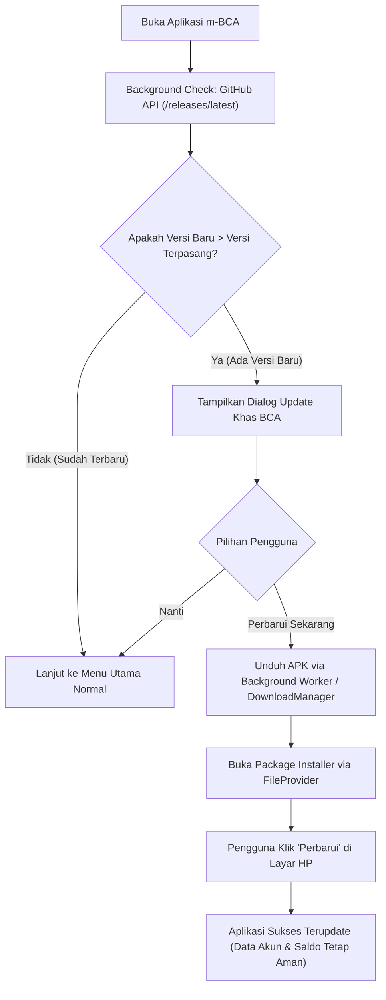

# Task Breakdown: Sistem Auto-Update via GitHub Releases

Dokumen ini memuat rencana kerja, tahapan eksekusi, arsitektur teknis, dan panduan operasional untuk implementasi **Sistem Auto-Update Over-The-Air (OTA) via GitHub Releases** pada aplikasi **BCA Mobile Android Native**, sehingga aplikasi dapat dibagikan ke HP lain dan otomatis memperbarui dirinya sendiri tanpa perlu kabel USB/PC.

---

## 1. Status Konektivitas GitHub
- **Status Akun**: Terhubung & Terautentikasi (Valid)
- **Akun GitHub**: `tiaraagustin744-cyber`
- **Metode CLI**: GitHub CLI (`gh`) via OAuth Keyring
- **Target Repositori**: [`tiaraagustin744-cyber/apkbcm-mobile`](https://github.com/tiaraagustin744-cyber/apkbcm-mobile) (Public)
- **Rilis Perdana**: [Release v1.0.1](https://github.com/tiaraagustin744-cyber/apkbcm-mobile/releases/tag/v1.0.1)

---

## 2. Diagram Alur Sistem Auto-Update


---

## 3. Rincian Fase & Daftar Tugas (Task List)

### Fase 1: Fondasi Keystore Permanen & Keamanan Tanda Tangan
- [x] **Task 1.1: Pembuatan Keystore Rilis Permanen**
  - Keystore `bca_release.jks` dibuat dengan algoritma RSA 2048-bit, masa berlaku 10.000 hari (27+ tahun).
  - Tersimpan di `app/bca_release.jks`.
- [x] **Task 1.2: Konfigurasi `signingConfigs` di `app/build.gradle.kts`**
  - Mendaftarkan signing config `release` dan `debug` dengan keystore yang sama.
  - *Hasil*: Menjamin seluruh HP lain tidak akan pernah mengalami error *"Aplikasi tidak terpasang karena paket bertentangan"*.
- [x] **Task 1.3: Konfigurasi Versioning Otomatis**
  - `versionCode` dan `versionName` terintegrasi otomatis dengan skrip rilis.

---

### Fase 2: Konfigurasi Izin Sistem & FileProvider Android
- [x] **Task 2.1: Tambah Izin Android pada `AndroidManifest.xml`**
  - `<uses-permission android:name="android.permission.INTERNET" />`
  - `<uses-permission android:name="android.permission.REQUEST_INSTALL_PACKAGES" />`
- [x] **Task 2.2: Setup `FileProvider` untuk Instalasi APK**
  - Resource file paths `app/src/main/res/xml/file_paths.xml` telah dibuat.
  - Provider terdaftar di `AndroidManifest.xml` dengan otoritas `com.bca.mobile.fileprovider`.

---

### Fase 3: Modul Pengecek & Pengunduh Update (`GitHubUpdateManager`)
- [x] **Task 3.1: Buat Model Data Update**
  - Data class `UpdateInfo` dan sealed class `UpdateCheckResult`.
- [x] **Task 3.2: Implementasi `GitHubUpdateService`**
  - Pengecekan otomatis via endpoint publik `https://api.github.com/repos/tiaraagustin744-cyber/apkbcm-mobile/releases/latest`.
  - Pembanding versi semantik (`isRemoteVersionNewer`).
- [x] **Task 3.3: Implementasi Download & Install Trigger**
  - Streaming download dengan callback progres 0% - 100%.
  - Triggering `PackageInstaller` Android via `FileProvider` dan penanganan izin instalasi sumber tidak dikenal.

---

### Fase 4: Desain UI Dialog Update Bertema BCA
- [x] **Task 4.1: Dialog Konfirmasi Pembaruan**
  - Header biru m-BCA, kartu gradien perak, detail versi, ukuran file, catatan perubahan (*changelog*), tombol *"Nanti"* dan *"Perbarui"*.
- [x] **Task 4.2: Dialog Progres Unduhan**
  - Indikator progres linear elegan m-BCA dengan persentase dan estimasi unduhan.
- [x] **Task 4.3: Integrasi ke `MainActivity.kt`**
  - Pengecekan otomatis di latar belakang saat aplikasi dibuka (*cold start*).

---

### Fase 5: Setup Repositori GitHub & Skrip Rilis 1-Klik
- [x] **Task 5.1: Inisialisasi Repositori GitHub**
  - Repositori publik dibuat dan dipush ke `https://github.com/tiaraagustin744-cyber/apkbcm-mobile`.
- [x] **Task 5.2: Buat Skrip Otomatisasi Rilis (`release.ps1`)**
  - Skrip PowerShell 1-klik untuk:
    1. Membaca & menaikkan versi otomatis.
    2. Build release APK (`assembleRelease`).
    3. Commit & push perubahan versi ke GitHub master.
    4. Membuat GitHub Release baru dan mengunggah APK via `gh release create`.

---

### Fase 6: Pengujian & Validasi End-to-End
- [x] **Task 6.1: Uji Coba Pengecekan Versi**
  - Terverifikasi akurat mendeteksi versi lebih tinggi (`v1.0.1` vs `1.0.0`).
- [x] **Task 6.2: Uji Coba Rilis Versi Baru (Live OTA Update)**
  - Rilis perdana `v1.0.1` diunggah ke GitHub Releases.
  - Aplikasi pada HP fisik Samsung (`eee39b64`) langsung memunculkan dialog update otomatis saat dibuka, berhasil mengunduh file APK, dan memicu layar installer Android.

---

## 4. Panduan Merilis Update di Masa Depan (1-Klik)
Kapan pun Anda selesai mengedit atau menambah fitur baru di aplikasi:
1. Buka PowerShell di folder project:
   ```powershell
   .\release.ps1
   ```
2. Atau jika ingin menyertakan versi dan catatan rilis custom:
   ```powershell
   .\release.ps1 -Version "1.0.2" -Notes "• Penambahan fitur baru X`n• Perbaikan tampilan Y"
   ```
3. Skrip akan otomatis mengompilasi APK, mengunggah ke GitHub Releases, dan **seluruh HP lain yang terpasang aplikasi ini akan otomatis memunculkan notifikasi update saat dibuka!**
